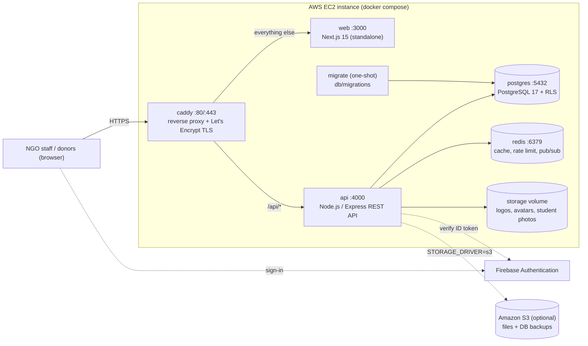

# Deployment Architecture & Guide (self-hosted, Docker, AWS)

The system runs as six Docker containers managed by `docker compose`. The
same `docker-compose.yml` is used on a laptop and on an AWS EC2 instance.

## 1. Production Topology



| Container | Image | Role |
|---|---|---|
| `caddy` | `caddy:2-alpine` | Single public entry point. Routes `/api/*` to the API and everything else to Next.js. Gets HTTPS certificates automatically when `SITE_ADDRESS` is a domain. |
| `web` | built from `Dockerfile` | Next.js frontend (`output: "standalone"`). No server-side data access. |
| `api` | built from `api/Dockerfile` | REST API: verifies the Firebase ID token, runs every query as the `authenticated` Postgres role with the caller's claims so the RLS policies in `db/migrations` apply, serves and stores files, and streams live committee votes over SSE. |
| `migrate` | same image as `api` | Runs at every deploy and exits. Applies new `db/migrations/*.sql`, seeds reference data, creates the least-privilege `app_api` DB role. |
| `postgres` | `postgres:17-alpine` | Database. Its port is bound to `127.0.0.1` only. |
| `redis` | `redis:7-alpine` | Pub/sub for live vote updates (replaces Supabase Realtime), lookup and token-verification cache, per-IP rate limiting. Holds no source-of-truth data. |

### Security model (unchanged from Supabase)

- **Authentication:** Firebase. The browser sends `Authorization: Bearer <ID token>`, or the HTTP-only `fb_id_token` cookie for `` and `EventSource` requests.
- **Authorization:** the same Postgres row-level security policies as before. For each request the API runs `set local role authenticated` and puts the verified claims in `request.jwt.claims`. `auth.jwt()` (defined in `db/migrations/0000_platform_bootstrap.sql`) reads them, just as PostgREST did. The API's login role `app_api` has **no** table privileges of its own, so a query that skipped this step would fail instead of bypassing RLS.
- **File storage:** files are stored privately and served only through the API. `student-documents` downloads are checked against `student_documents` RLS. Logos and avatars are public.

## 2. Deploying on AWS EC2 (recommended)

### 2.1 AWS resources

1. **EC2 instance:** Amazon Linux 2023 or Ubuntu 24.04, **t3.medium** (2 vCPU, 4 GB) or larger, with a 30 GB gp3 root volume.
2. **Security group:** inbound **80** and **443** from anywhere, and **22** from your office IP only. No database ports.
3. **Elastic IP** attached to the instance, and a DNS **A record** (e.g. `tracker.example.org`) pointing to it.
4. *(Recommended)* **S3 bucket** for uploaded files and/or DB backups, plus an **IAM instance role** with this policy (no access keys needed):
   ```json
   {
     "Version": "2012-10-17",
     "Statement": [{
       "Effect": "Allow",
       "Action": ["s3:GetObject", "s3:PutObject", "s3:ListBucket"],
       "Resource": ["arn:aws:s3:::YOUR-BUCKET", "arn:aws:s3:::YOUR-BUCKET/*"]
     }]
   }
   ```
5. **Firebase console:** under Authentication → Settings → **Authorized domains**, add the new domain.

### 2.2 First deployment, one command from your computer (recommended)

From the project folder on your computer (Git Bash on Windows):

```bash
./scripts/backup-db.sh                                   # fresh dump of your local data
./scripts/remote-deploy.sh ec2-user@<elastic-ip> \
    --key ~/Downloads/<your-key>.pem \
    --domain tracker.example.org \
    --data backups/<latest>.dump
```

The script:
1. Copies the app to the server. Secrets, `node_modules` and local data are left out.
2. Installs Docker the first time.
3. Creates the server's `.env` with new passwords and your Firebase keys.
4. Builds and starts everything.
5. Uploads your database dump and restores it. You'll be asked to type `restore`.

Use `ubuntu@...` instead of `ec2-user@...` for Ubuntu servers. Leave out
`--domain` to use plain HTTP on the IP address. Re-run the same command
without `--data` to ship code updates.

### 2.2b First deployment, manually on the server

```bash
ssh ec2-user@<elastic-ip>
git clone <repo-url> selection-tracker && cd selection-tracker
sudo ./scripts/setup-server.sh          # Docker, compose, AWS CLI, swap
exit                                    # log out/in so the docker group applies
ssh ec2-user@<elastic-ip> && cd selection-tracker

./scripts/init-env.sh tracker.example.org   # creates .env with generated DB/Redis passwords
nano .env                                   # fill in NEXT_PUBLIC_FIREBASE_* and FIREBASE_ADMIN_*
                                            # optional: STORAGE_DRIVER=s3, S3_BUCKET=..., BACKUP_S3_URI=...
./scripts/deploy.sh
```

`deploy.sh` builds the images, starts Postgres and Redis, runs migrations,
starts the API, web and Caddy containers, and waits for `/api/health`. Caddy
obtains the TLS certificate on the first HTTPS request.

### 2.3 Moving existing data from Supabase (one time)

```bash
export SUPABASE_DB_URL='postgresql://postgres.<ref>:<password>@aws-0-<region>.pooler.supabase.com:5432/postgres'
export SUPABASE_URL='https://<ref>.supabase.co'
export SUPABASE_SERVICE_ROLE_KEY='<service_role key>'
./scripts/import-from-supabase.sh
```

The script copies all `public` rows (data only, since the schema already
comes from `db/migrations`), copies every file from the `partner-logos`,
`avatars` and `student-documents` buckets, and rewrites stored logo and avatar
URLs. Users keep signing in with the same Firebase accounts. After verifying
the data, the Supabase project can be paused or deleted.

### 2.4 Updates

```bash
./scripts/deploy.sh --pull     # git pull, pre-deploy backup, build, migrate, restart
```

Migrations always run before the new API starts. Keep migrations additive:
never drop a column in the same release that stops using it.

### 2.5 Backups

```bash
./scripts/backup-db.sh                      # pg_dump (+ uploaded files when STORAGE_DRIVER=local)
./scripts/restore-db.sh backups/<file>.dump # destructive; asks for confirmation
```

Schedule a daily backup with cron (`crontab -e`):

```
30 2 * * * cd /home/ec2-user/selection-tracker && ./scripts/backup-db.sh >> backups/backup.log 2>&1
```

Set `BACKUP_RETENTION_DAYS` (local copies to keep) and `BACKUP_S3_URI` in
`.env` to keep off-instance copies in S3. Also enable **EBS snapshots** of
the instance volume (Data Lifecycle Manager) as a second layer.

## 3. Scaling options on AWS

The containers are stateless except `postgres`, `redis` and the `storage`
volume, so each one can move to a managed service by changing `.env`:

| Need | Change |
|---|---|
| Files outside the instance | `STORAGE_DRIVER=s3`, `S3_BUCKET=...` (IAM role). Required before running more than one API instance. |
| Managed database (Multi-AZ, PITR) | Create an **RDS for PostgreSQL 17** instance and point `MIGRATION_DATABASE_URL` and `DATABASE_URL` at it (`DATABASE_SSL=true`). Remove the `postgres` service from compose. The migrator creates the `authenticated`/`app_api` roles there too. |
| Managed Redis | **ElastiCache for Redis/Valkey**: set `REDIS_URL` (use `rediss://` with in-transit encryption). |
| TLS at a load balancer | Put an **ALB** with an ACM certificate in front, set `SITE_ADDRESS=:80` and `TRUST_PROXY=2`. |
| Containers without servers | Push both images to **ECR** and run `web` and `api` as **ECS Fargate** services behind the ALB, with path rule `/api/*` → api and default → web. Run `migrate` as a one-off ECS task before each deploy. |

## 4. Environment variables

All variables are documented in [`.env.example`](../.env.example), and
`api/.env.example` covers running the API outside Docker. Summary:

| Variable | Used by | Purpose |
|---|---|---|
| `SITE_ADDRESS` | caddy | `:80` or your domain (automatic HTTPS) |
| `POSTGRES_*`, `APP_DB_*` | postgres, migrate, api | Database and least-privilege runtime role |
| `REDIS_PASSWORD` | redis, api | Redis auth |
| `NEXT_PUBLIC_FIREBASE_*` | web (build time) | Firebase web config |
| `FIREBASE_ADMIN_*` | api | Firebase Admin SDK service account |
| `STORAGE_DRIVER`, `S3_*` | api | `local` volume or `s3` |
| `RATE_LIMIT_PER_MINUTE`, `TRUST_PROXY` | api | Abuse protection, real client IPs |
| `BACKUP_S3_URI`, `BACKUP_RETENTION_DAYS` | scripts | Backups |

## 5. Monitoring

- `GET /api/health` reports database and Redis status (Caddy, ALB and Docker healthchecks use it).
- Logs: `docker compose logs -f api web caddy`. Consider shipping them to CloudWatch with the `awslogs` driver or the CloudWatch agent.
- Set a CloudWatch alarm on instance CPU, disk usage and status checks.

## 6. Release checklist (per scholarship cycle)

1. A Super Admin creates the new `selection_cycles` row (`status='planning'`) ahead of the information-session stage. Cycle lookups are cached for 60 seconds.
2. Confirm the GeoJSON and province seed data are unchanged.
3. Run UAT with the field teams before the exam stage, which has the highest bulk-import volume.
4. Set the cycle `status` to `active` when intake opens, then to `closed` and `archived` after final reporting.
